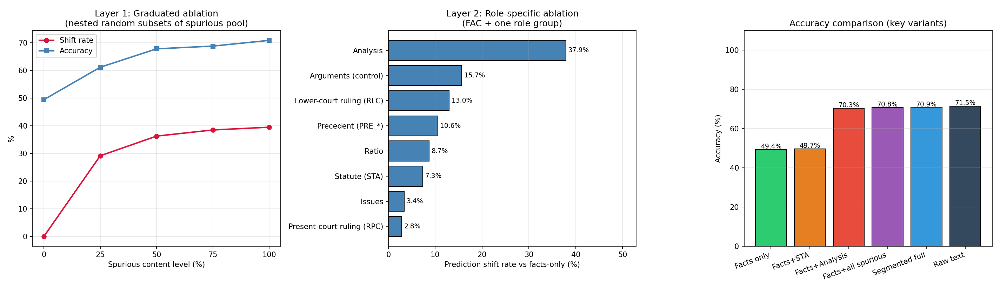

# Detecting Shortcut Learning in Indian Legal Judgment Prediction

Legal judgment prediction (LJP) models often score well on Indian court data. This project asks **why**: do they predict the outcome from the *facts of the case*, or from parts of the judgment that already reveal the outcome (the court's reasoning, statutes, precedents)? We train a hierarchical long-document classifier, segment judgments into rhetorical roles, and run a layered ablation on the frozen model to measure how much each role drives its predictions.

## Key findings

Model: hierarchical InLegalBERT + BiGRU, evaluated on PredEx (accepted vs rejected).

| Input given to the model | Accuracy |
|---|---|
| Facts only | 49.4% |
| Facts + statutes (STA) | 49.7% |
| Facts + reasoning (ANALYSIS) | 70.3% |
| Facts + all spurious roles | 70.8% |
| Segmented full text | 70.9% |
| Raw full text (baseline) | 71.5% |

- With facts alone the model is at chance level. Nearly all of its ~71% comes from the judgment's reasoning, which is not information available when a case is first filed.
- Per-role **shift rate** (how often predictions change versus facts-only): ANALYSIS 37.9%, Arguments (control) 15.7%, RLC 13.0%, Precedents 10.6%, Ratio 8.7%, Statutes 7.3%, Issues 3.4%, RPC 2.8%.
- Adding spurious content in 25/50/75/100% doses raises accuracy from about 49% to about 71% and the shift rate from 0 to about 39%.
- Statute citations are *not* the main shortcut, contrary to the initial hypothesis.



> **Note on evaluation data:** overlap between the ILDC training data and the PredEx test set was filtered with a sliding-window matcher plus TF-IDF verification. A stricter shingle-based re-check is in progress, so final numbers may shift slightly.

## Method

1. **Train.** Each judgment is split into 512-token chunks (stride 256, up to 16). InLegalBERT embeds each chunk's `[CLS]`; a 2-layer BiGRU aggregates the chunks; a linear layer classifies. The last 3 BERT layers and the pooler are unfrozen (24.6M of 112.2M parameters). Training data is the criminal subset of ILDC / IL-TUR CJPE (7,094 train, 154 dev). Dev macro-F1 is 0.7319, up from 0.5475 for a frozen-encoder baseline.
2. **Segment.** OpenNyAI assigns each sentence one of 13 rhetorical roles (PREAMBLE, FAC, RLC, ISSUE, ARG_PETITIONER, ARG_RESPONDENT, ANALYSIS, STA, PRE_RELIED, PRE_NOT_RELIED, RATIO, RPC, NONE).
3. **Ablate** (no retraining, inference only):
   - **Layer 1, dose-response:** facts plus 25/50/75/100% of a nested random subset of the spurious pool (STA, PRE_RELIED, PRE_NOT_RELIED, RLC, RPC, ANALYSIS).
   - **Layer 2, role-by-role:** facts plus one role group at a time. Arguments act as a control.
   - **Layer 3, counterfactual:** statute section numbers swapped or masked.
   - **Baselines:** `v_full` (segmented sentences in document order) and `v_raw` (original text).
4. **Measure.** Accuracy, shift rate versus facts-only, conditional shift rate, and Wilson 95% confidence intervals, all on a common case set.

## Repository structure

```
.
├── training/
│   ├── train_unfrozen.ipynb         # trains the hierarchical InLegalBERT + BiGRU model
│   └── eval_predex_test.ipynb       # evaluates the checkpoint on PredEx
├── data_preprocessing/
│   ├── 01_ildc_eda_preproc.ipynb    # IL-TUR CJPE exploration and cue analysis
│   ├── 02_ildc_criminal_filter.ipynb# criminal-case filter, train/dev split
│   ├── 03_remove_overlaps.ipynb     # removes ILDC/PredEx overlaps
│   └── 04_verify_overlaps.ipynb     # verifies flagged overlap pairs
├── ablation/
│   ├── opennyai_ablation_fixed.py   # corrected two-stage ablation pipeline (v2)
│   ├── predex_ablation_results_v2.json
│   └── combined_ablation_v2.png
├── legacy_v1/                       # first ablation attempt, kept for history
├── requirements.txt                 # pinned, verified for Python 3.10
└── README.md
```

### Why `legacy_v1/` exists
The first ablation had segmentation bugs: STA and ISSUE sentences were collapsed into NONE, the `v_sta_only` variant actually contained FAC + ANALYSIS, and variants were compared on different case sets. Its statute and issue conclusions are **invalid**. It is kept only to document the correction; use `ablation/` for all results.

## Reproducing the ablation

Model weights and data are not stored in this repo (see `.gitignore`). They live on Hugging Face:

- Model checkpoint: `Capstone-LawAI/capstone-legal`
- Data: `Capstone-LawAI/legal-data`

```bash
# 1. Environment (Python 3.10)
git clone https://github.com/smruthi-bs/capstone.git && cd capstone
python3.10 -m venv .venv && source .venv/bin/activate
pip install -r requirements.txt

# 2. Download checkpoint, data and InLegalBERT into ./hf_files
huggingface-cli login
huggingface-cli download Capstone-LawAI/capstone-legal --local-dir hf_files
huggingface-cli download Capstone-LawAI/legal-data --repo-type dataset --local-dir hf_files

# 3. Run (GPU recommended)
python ablation/opennyai_ablation_fixed.py
```

The script runs in two stages. Stage 1 segments the PredEx test set with OpenNyAI and caches the result to `predex_opennyai_raw_v2.json`. Stage 2 builds the variants, runs the model, and writes `predex_ablation_results_v2.json` and `combined_ablation_v2.png`. The paths `CSV_PATH`, `CHECKPOINT_PATH` and `MODEL_NAME` are set in the config block at the top of the script.

**Dependency notes:** OpenNyAI 0.0.13 needs an older stack (`spacy 3.2.5`, `transformers 4.20.1`, `numpy 1.26.4`, `click<8.2`), which is why versions are pinned. The checkpoint loader fails loudly on any weight mismatch rather than loading silently.

## Limitations

- Results depend on OpenNyAI segmentation quality.
- Ablation shows the model *relies on* these cues. It does not prove why training produced that reliance.
- The test set is 1,346 PredEx cases, so small role differences (e.g. STA 7.3% vs RATIO 8.7%) are not statistically distinguishable.
- Removing text changes the input distribution, which can cause some shift by itself. The Arguments control helps bound this.
- The counterfactual replacement section number (144) is a real CrPC section, so it is not perfectly neutral.

## Team

Smruthi B S, Subashri V, Thanushree C B, Vidyashree M B. Guide: Dr. Mohammad Asif Raibag, PES University.

## Acknowledgements

[InLegalBERT](https://huggingface.co/law-ai/InLegalBERT), [OpenNyAI](https://github.com/OpenNyAI/Opennyai), IL-TUR / ILDC, and PredEx.
